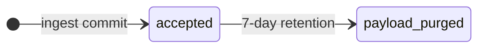
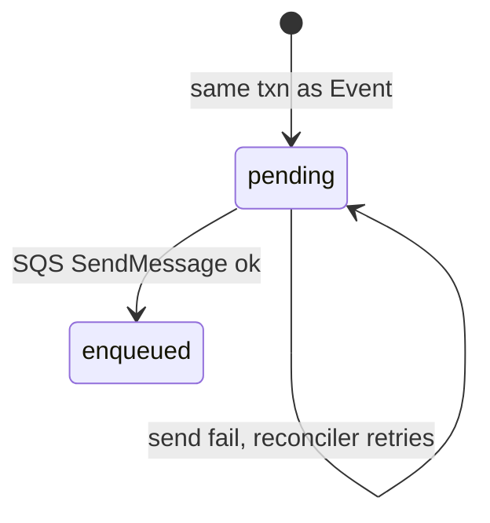
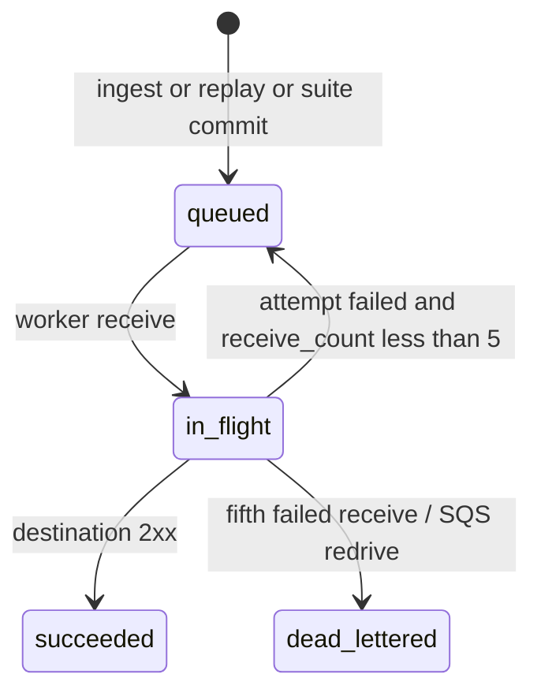
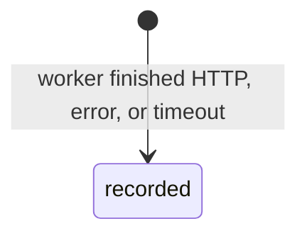
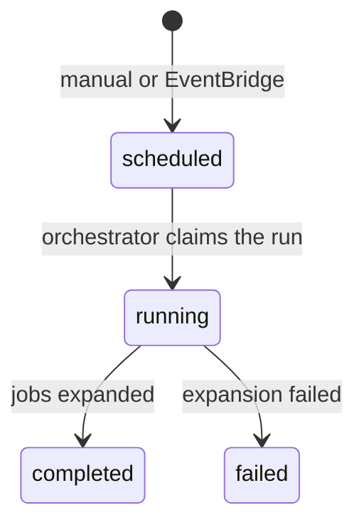

# State machines

Statuses below are closed enums. Database `CHECK` constraints and application code must use these exact strings. Transitions are the only legal updates; anything else is a bug.

Pipeline reminder: provider POST → ingest Lambda → Postgres (Event + Delivery + OutboxJob) → `202` → SQS → worker → destination → append-only DeliveryAttempt.

## Event

An Event is the accepted, immutable capture of one provider delivery. Rejected ingestions are not stored (see [failure-model.md](failure-model.md)).

| Status          | Meaning |
| --------------- | ------- |
| `accepted`      | Event row committed with body. `202` has been or is about to be returned. |
| `payload_purged`| Body set to null after seven-day retention. Metadata, `byte_size`, and related deliveries remain. |

Rules:

- Created only after validation succeeds and the ingest transaction commits.
- Body is never updated except to null on purge.
- A provider retry of the same `(source_id, provider_delivery_id)` does not create a second Event and does not change this status (see [ADR 0002](adr/0002-idempotency-keys.md)).

## OutboxJob

OutboxJob is a Postgres row that means “this delivery still needs to be published to SQS.” It is not the delivery queue. SQS takes over once the row is `enqueued` ([ADR 0001](adr/0001-outbox-boundary.md)).

| Status     | Meaning |
| ---------- | ------- |
| `pending`  | Committed in Postgres; not yet successfully published to SQS, or not yet eligible (`release_after` in the future). |
| `enqueued` | `SendMessage` succeeded. Delivery retries are now SQS’s job. |

Rules:

- Written in the **same transaction** as the Event and the initial Delivery.
- The SQS message body is the OutboxJob id, not the payload.
- The reconciler selects `pending` rows whose `release_after <= now()` and whose `created_at` is older than the enqueue-grace window (or whose last publish attempt failed).
- Terminal for the outbox is `enqueued`. The Delivery state machine owns success, retry, and DLQ after that.

## Delivery

A Delivery is one dispatch of one Event to one destination. The initial ingest creates one. Manual replay and suite expansion each create new Delivery rows. They never reuse or rewrite an old one.

| Status          | Meaning |
| --------------- | ------- |
| `queued`        | Waiting for a worker. Includes the window before SQS publish succeeds. |
| `in_flight`     | A worker has received the SQS message (visibility timeout is hiding it). |
| `succeeded`     | Destination returned 2xx. Terminal. |
| `dead_lettered` | Automatic delivery gave up after five receives. Terminal for auto-delivery. Replay creates a new Delivery. |

Rules:

- Created in the same transaction as its OutboxJob, in `queued`.
- `replayed_from_delivery_id` is set only on replay Deliveries.
- `suite_run_id` is set only on suite-expanded Deliveries.
- If a worker receives a message whose Delivery is already `succeeded`, it must not POST again; it deletes the SQS message ([ADR 0003](adr/0003-retry-ownership.md)).
- `in_flight` → `queued` on a failed attempt with `receive_count < 5` reflects that SQS will make the same message visible again after the visibility timeout. The worker does not call `SendMessage` to retry.

## DeliveryAttempt

A DeliveryAttempt is one finished try. Rows are insert-only.

| Status     | Meaning |
| ---------- | ------- |
| `recorded` | The try completed (success, HTTP error, timeout, connect error, SSRF block, CLI disconnect, or unhandled worker error). |

Rules:

- There is no `in_progress` row. A crash before insert is retried by SQS; the next receive writes a new attempt.
- `attempt_number` equals SQS `ApproximateReceiveCount` for that message.
- Unique `(delivery_id, attempt_number)` prevents two rows for the same try.
- Outcomes are never updated. Replay inserts a new Delivery, which starts its own attempt numbers at 1.

## SuiteRun

A SuiteRun is one execution of a saved ScenarioSuite, either started by the user or by EventBridge Scheduler.

| Status      | Meaning |
| ----------- | ------- |
| `scheduled` | Row created; orchestrator has not yet expanded it into deliveries. |
| `running`   | Orchestrator has claimed the row and is creating deliveries / outbox jobs. |
| `completed` | All planned deliveries and outbox jobs exist. Terminal. |
| `failed`    | Expansion threw after claim. Terminal. Operator retries by creating a new run. |

Rules:

- Unique `(suite_id, scheduled_for)` so a double scheduler fire cannot create two runs.
- `scheduled_for` is `NOT NULL` for every run. Manual runs set it to the request timestamp. Scheduled runs set it to the EventBridge fire time they were planned for.
- Claiming is an atomic `scheduled → running` update. The loser of a race sees zero rows updated and exits.
- Expanding a suite does not deliver HTTP itself. It inserts Delivery + OutboxJob rows with `release_after` timestamps so delay and reordering are explicit ([ADR 0004](adr/0004-sqs-standard.md)).
